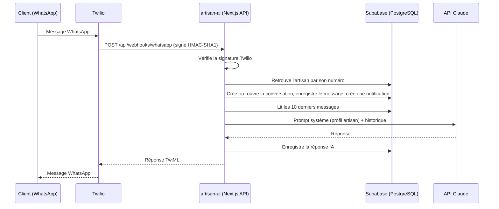

# artisan-ai

**L'assistant WhatsApp qui répond aux clients d'un artisan pendant qu'il est sur un chantier.**

Un plombier ou un électricien rate des demandes tous les jours parce qu'il a les mains prises. artisan-ai répond à sa place sur WhatsApp, en quelques secondes et avec son ton. Il connaît ses services, garde le contexte de la conversation et lui remonte tout dans un tableau de bord. L'artisan peut reprendre la main à tout moment.

🔗 **Démo en ligne :** https://artisan-ai-nine.vercel.app (bouton « Essayer la démo », compte en lecture seule)

<!-- TODO : 🎬 **Vidéo (2 min) :** lien de la vidéo -->

<!-- TODO : capture d'écran du tableau de bord + capture d'une conversation WhatsApp -->
<!--  -->

---

## Fonctionnalités

- **Réponse automatique sur WhatsApp** : chaque message client reçu via Twilio déclenche une réponse générée par Claude, à partir du profil de l'artisan (entreprise, présentation, services) et des 10 derniers messages de la conversation.
- **Tableau de bord artisan** : conversations ouvertes et fermées, historique complet (client, IA, artisan), statistiques, profil incomplet signalé.
- **Reprise en main** : l'artisan répond lui-même depuis le tableau de bord, et le message part sur WhatsApp via l'API Twilio.
- **Notifications** : nouvelle conversation, nouveau message, menu déroulant de notifications non lues.
- **Abonnements Stripe** : trois offres (Starter 19 €, Pro 49 €, Équipe 99 €), Checkout, portail client, statut synchronisé par webhooks (actif, en retard de paiement, annulé).
- **Compte de démonstration public**, en lecture seule, avec les numéros clients masqués.

## Architecture



```
src/
├── app/
│   ├── (auth)/            # connexion, inscription
│   ├── (dashboard)/       # tableau de bord, conversations, profil, facturation
│   └── api/
│       ├── webhooks/whatsapp/   # entrée Twilio → IA → réponse
│       └── billing/             # checkout, portail, webhook Stripe
├── components/            # UI (shadcn/ui), tableau de bord, landing
├── lib/
│   ├── actions/           # server actions (messages, profil, notifications, auth)
│   ├── supabase/          # clients navigateur / serveur / admin + middleware de session
│   ├── stripe.ts, plans.ts
│   └── demo.ts            # garde du compte de démonstration
└── types/database.ts      # types du schéma
```

### Modèle de données

| Table | Rôle |
|---|---|
| `profiles` | artisan : entreprise, présentation, services, numéro WhatsApp |
| `conversations` | une par couple artisan / numéro client, statut `open` / `closed` |
| `messages` | `from_type` : `client`, `ai` ou `artisan` |
| `notifications` | nouvelle conversation / nouveau message, lu / non lu |
| `subscriptions` | client et abonnement Stripe, offre, statut, fin de période |

## Choix techniques

- **Webhooks authentifiés.** Les requêtes Twilio sont vérifiées par signature HMAC-SHA1 avec une comparaison à temps constant (`timingSafeEqual`). Les événements Stripe sont vérifiés avec `constructEvent` sur le corps brut. Une requête non signée ne touche jamais la base.
- **Isolation des données par artisan.** Côté application, toutes les requêtes du tableau de bord sont filtrées par `artisan_id = user.id`. <!-- TODO : confirmer et décrire les politiques Row Level Security activées dans Supabase, idéalement en ajoutant les migrations SQL dans supabase/migrations/ --> Seuls les webhooks, qui ne sont pas authentifiés par session, utilisent la clé `service_role`.
- **Un compte de démo sûr.** Le mode démo est déterminé par l'**identité** du compte, pas par un cookie. Un visiteur ne peut donc pas s'en débarrasser pour obtenir les droits d'écriture. Toutes les actions qui écrivent (envoi de message, profil, checkout) sont bloquées, et les numéros des clients sont masqués (RGPD).
- **Un format adapté à WhatsApp.** Le prompt impose du texte brut, des messages courts, le français et le ton de l'artisan, car WhatsApp n'affiche pas le markdown.
- **Une facturation pilotée par les webhooks.** L'état de l'abonnement en base suit uniquement les événements Stripe (`checkout.session.completed`, `customer.subscription.updated` / `deleted`, `invoice.payment_failed`), jamais la redirection du navigateur.

## Stack

Next.js 16 (App Router, server actions) · React 19 · TypeScript · Supabase (PostgreSQL, Auth) · Stripe · Twilio WhatsApp API · API Claude (Anthropic) · Tailwind CSS 4 · shadcn/ui · Vercel

## Lancer le projet en local

```bash
git clone https://github.com/amad-khaly-diallo/artisan-ai.git
cd artisan-ai
npm install
cp .env.example .env.local   # puis remplir les variables
npm run dev
```

### Variables d'environnement

| Variable | Usage |
|---|---|
| `NEXT_PUBLIC_SUPABASE_URL`, `NEXT_PUBLIC_SUPABASE_ANON_KEY` | client Supabase |
| `SUPABASE_SERVICE_ROLE_KEY` | client admin (webhooks uniquement) |
| `STRIPE_SECRET_KEY`, `STRIPE_WEBHOOK_SECRET` | paiements |
| `STRIPE_PRICE_STARTER`, `STRIPE_PRICE_PRO`, `STRIPE_PRICE_TEAM` | IDs des prix Stripe |
| `TWILIO_ACCOUNT_SID`, `TWILIO_AUTH_TOKEN`, `TWILIO_WHATSAPP_NUMBER` | envoi et réception WhatsApp |
| `TWILIO_WEBHOOK_URL` | URL publique exacte utilisée pour vérifier la signature |
| `ANTHROPIC_API_KEY` | génération des réponses |
| `NEXT_PUBLIC_APP_URL` | URLs de retour Stripe |
| `DEMO_USER_ID`, `DEMO_EMAIL`, `DEMO_PASSWORD` | compte de démonstration |

Pour tester WhatsApp en local : utilisez le **sandbox WhatsApp de Twilio** et exposez `localhost:3000` avec un tunnel (ngrok ou cloudflared). En développement, les messages entrants sont rattachés au dernier utilisateur connecté.

Pour Stripe en local : `stripe listen --forward-to localhost:3000/api/billing/webhook` (mode test, cartes de test Stripe).

## Pistes d'évolution

- Ajouter les migrations SQL et les politiques RLS dans le dépôt.
- Ajouter des tests (vérification des signatures, logique du webhook, garde de démo).
- Traiter la génération IA hors du cycle du webhook (file de messages) pour ne pas dépendre du délai de Twilio.
- Prévoir un renvoi vers l'artisan quand l'IA n'est pas sûre (urgence, devis chiffré, réclamation).
- Appliquer les quotas par offre (50 réponses IA par mois pour Starter).

---

Projet réalisé par **Amad Khaly Diallo**, développeur back-end Node.js / TypeScript. [Portfolio](https://amaddiallo.dev) · [LinkedIn](https://www.linkedin.com/in/amad-khaly-diallo/)
